<picture><source media="(prefers-color-scheme: dark)" srcset="portfolio/archive-hero-dark.svg"></picture>

[Telegram](https://t.me/kyleuss) · [Steam](https://steamcommunity.com/id/Kyleuss/) · [Discord](https://discord.com/users/723520555348656138)

### 01 / ABOUT

Software, desktop utilities, web experiences and game visuals. Minimal interfaces, motion and monochrome design.

<a href="https://github.com/Ryoko-Development"><picture><source media="(prefers-color-scheme: dark)" srcset="portfolio/archive-org-dark.svg"></picture></a>

### 02 / TOOLKIT

`C++` `C#` `Java` `Python` `JavaScript` `TypeScript`  
`.NET / WPF` `Fabric` `Node.js` `React` `Cloudflare Workers` `Git` `GitHub Actions`

### 03 / REPOSITORIES (11)

| Repository | Stack |
| :--- | :--- |
| `ryoko-tweaker` | C# / WPF / .NET |
| `Ryoko-visuals-1.21.11` | Java / Fabric |
| `Ryoko-CS2` | C++ |
| `rustbot` | JavaScript / Cloudflare |
| `ryoko-website` | React / TypeScript |
| `kyleus-resources` | PNG / Assets |
| `kyleus-archive` | HTML / CSS / JavaScript |
| `no.peek-website-bio` | TypeScript / Next.js |
| `kyleus-developer-bot` | JavaScript / Cloudflare |
| `kyleus-dev-panel` | HTML / CSS / JavaScript |
| `kyleusdev` | Markdown / JavaScript |

### 04 / ACTIVITY

<picture><source media="(prefers-color-scheme: dark)" srcset="portfolio/archive-activity-dark.svg"></picture>

[Browse public repositories](https://github.com/kyleusdev?tab=repositories)
