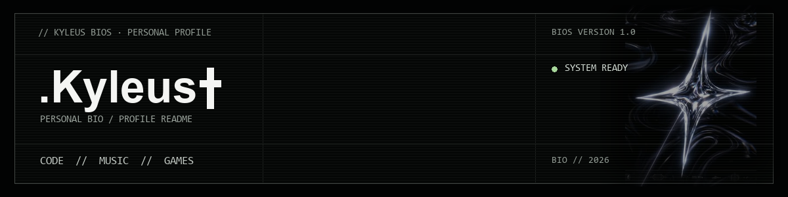
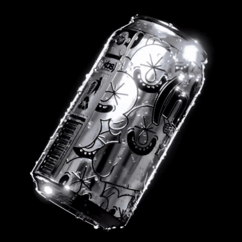

  

  <code>UNDERGROUND ARCHIVE 2026</code> &nbsp;✦&nbsp; <code>PERSONAL ARCHIVE</code>

<table>
  <tr>
    <td valign="top" width="68%">
      
<code>01 // ABOUT</code>

      
I'm <strong>.Kyleus✞</strong>. This profile is my little corner for code, personal projects, and things I want to keep around. I’m into programming, music, and games.

      
<code>02 // CURRENT PROJECT</code>

      
<strong>Kyleus BIO</strong> is my personal site, styled like an old BIOS screen. It has a boot-up sequence, a retro computer with a terminal, a music player, and a live GitHub activity section.

      
<a href="https://kyleus.vercel.app/">OPEN THE BIO ↗</a>

    </td>
    <td align="center" valign="middle" width="32%">
      
       CHROME FORM / MOTION
       <a href="assets/chrome-study-source.mp4">SOURCE CLIP ↗</a>
    </td>
  </tr>
</table>

## `03 // CODE`

<code>C++</code> &nbsp; <code>Python</code> &nbsp; <code>JavaScript</code>

  <a href="https://t.me/kyleuss">TELEGRAM</a> &nbsp;✦&nbsp;
  <a href="https://steamcommunity.com/id/Kyleuss/">STEAM</a> &nbsp;✦&nbsp;
  <a href="https://discord.com/users/723520555348656138">DISCORD</a>

