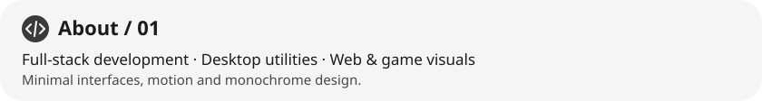
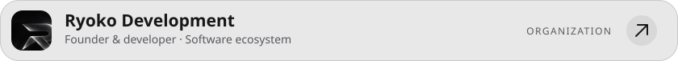

<picture><source media="(prefers-color-scheme: dark)" srcset="portfolio/intro-dark.svg"></picture>

<picture><source media="(prefers-color-scheme: dark)" srcset="assets/social-l-dark.svg?v=5f74a15ef7f4"></picture><a href="https://t.me/kyleuss"><picture><source media="(prefers-color-scheme: dark)" srcset="assets/social-1-dark.svg?v=0570ad26bb28"></picture></a><a href="https://steamcommunity.com/id/Kyleuss/"><picture><source media="(prefers-color-scheme: dark)" srcset="assets/social-2-dark.svg?v=46183e9cbcf8"></picture></a><a href="https://steamcommunity.com/id/kyleusss/"><picture><source media="(prefers-color-scheme: dark)" srcset="assets/social-3-dark.svg?v=7e5adcf50fba"></picture></a><a href="https://discord.com/users/723520555348656138"><picture><source media="(prefers-color-scheme: dark)" srcset="assets/social-4-dark.svg?v=e0e34f64d373"></picture></a><picture><source media="(prefers-color-scheme: dark)" srcset="assets/social-r-dark.svg?v=13591836c07d"></picture>

<picture><source media="(prefers-color-scheme: dark)" srcset="portfolio/about-compact-dark.svg"></picture>

<a href="https://github.com/Ryoko-Development"><picture><source media="(prefers-color-scheme: dark)" srcset="portfolio/ryoko-brand-dark.svg"></picture></a>

<picture><source media="(prefers-color-scheme: dark)" srcset="assets/stack-dark.svg"></picture>

<picture><source media="(prefers-color-scheme: dark)" srcset="portfolio/clean-repositories-dark.svg"></picture>

<picture><source media="(prefers-color-scheme: dark)" srcset="portfolio/activity-dark.svg"></picture>

<picture><source media="(prefers-color-scheme: dark)" srcset="assets/streak-dark.svg"></picture>

<picture><source media="(prefers-color-scheme: dark)" srcset="assets/wave-dark.svg"></picture>

<a href="https://github.com/kyleusdev?tab=repositories"><picture><source media="(prefers-color-scheme: dark)" srcset="assets/button-1-dark.svg"></picture></a>

